# Maquettes : module Entreprises & Candidatures 

Captures des écrans réalisés. Navigation par hash : `#entreprises` et `#entreprises/candidatures`.

## 1. Liste des entreprises (admin / responsable)

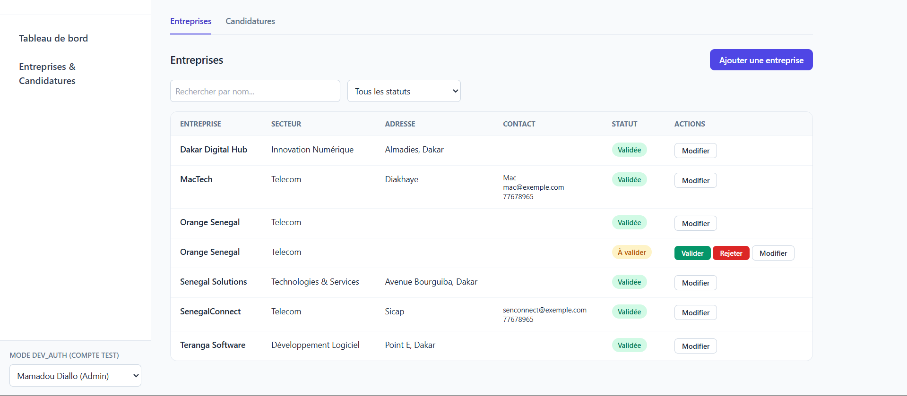

Tableau des entreprises avec recherche par nom  et filtre par statut
(à valider, validée, rejetée). Un étudiant voit uniquement les entreprises validées et ses propres propositions.

## 2. Formulaire d'ajout ou de proposition

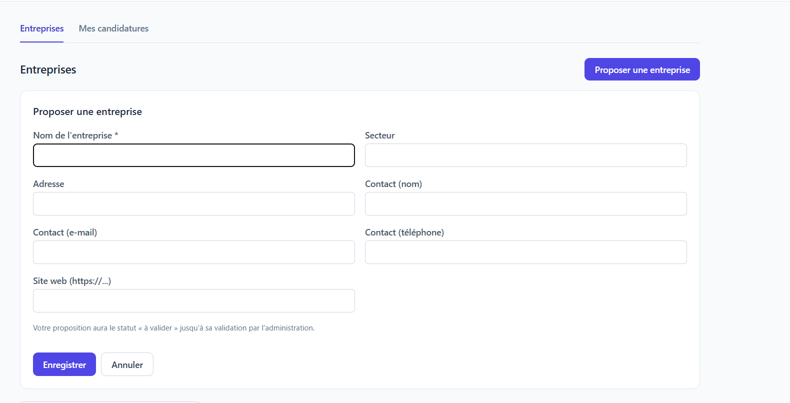

L'administration crée directement une entreprise « validée ». Un étudiant la propose : elle passe
en « à valider » et l'administration reçoit une notification.

## 3. Alerte de doublon

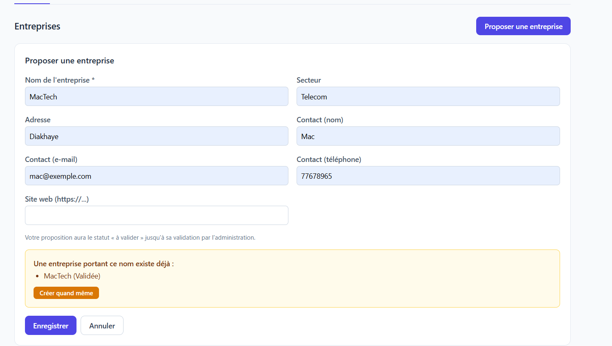

Si le nom existe déjà (casse ignorée), l'API répond 409 avec la liste des doublons.
L'utilisateur peut annuler ou confirmer avec « Créer quand même ».

## 4. Validation par l'administration

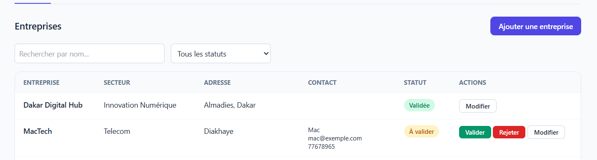

L'administration valide, rejette ou modifie une entreprise proposée. Le proposant est notifié.

## 5. Mes candidatures (étudiant)

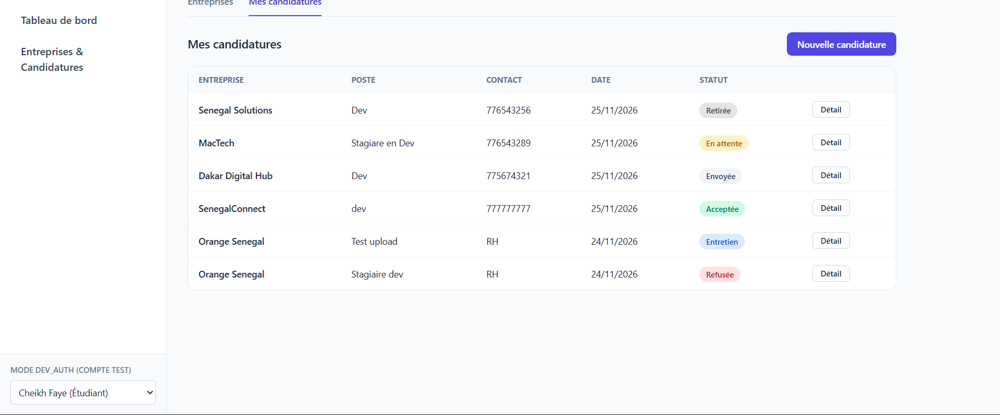

Suivi des candidatures et de leur statut : envoyée, en attente, entretien, acceptée, refusée, retirée.
L'administration voit toutes les candidatures en lecture seule.

## 6. Détail d'une candidature

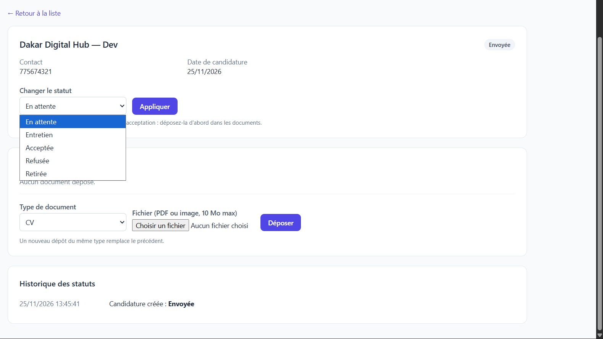

Changement de statut (« acceptée » exige une preuve d'acceptation), dépôt de documents
(CV, lettre, preuve ; PDF ou image, 10 Mo maximum), téléchargement protégé et historique daté des statuts.

---

# Module C : Stages & Conventions (issue #16)

Navigation par hash : `#conventions`, `#conventions/nouvelle`, `#conventions/<id>`, `#conventions/<id>/modifier`.

## 1. Liste (étudiant)
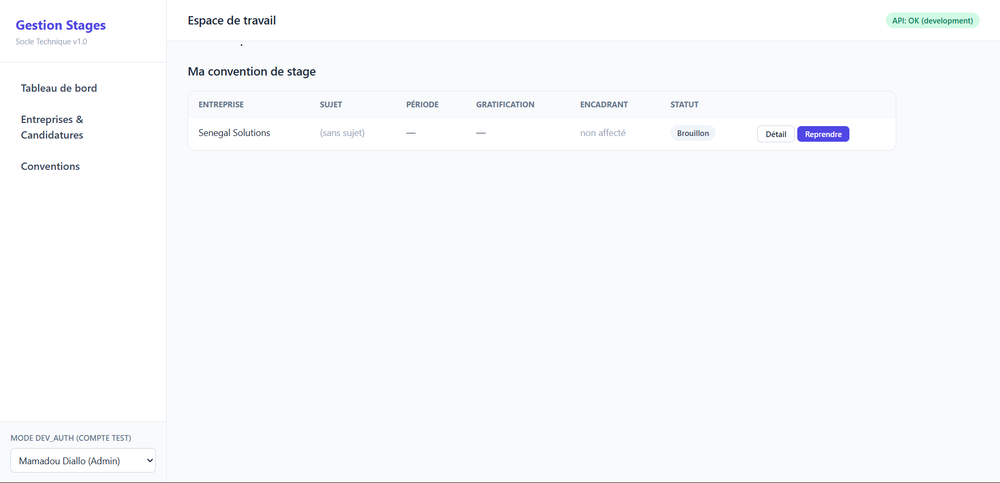

## 2. Formulaire en étapes : entreprise
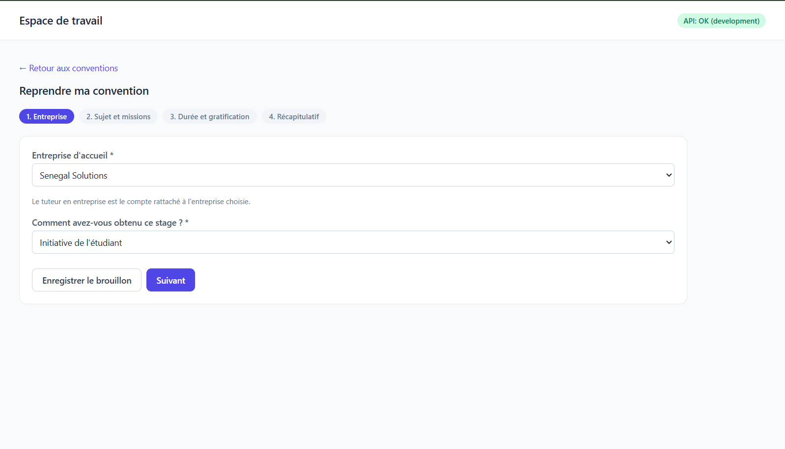

Quatre étapes (entreprise, sujet et missions, durée et gratification, récapitulatif). Chaque étape enregistre le brouillon.

## 3. Récapitulatif avant soumission
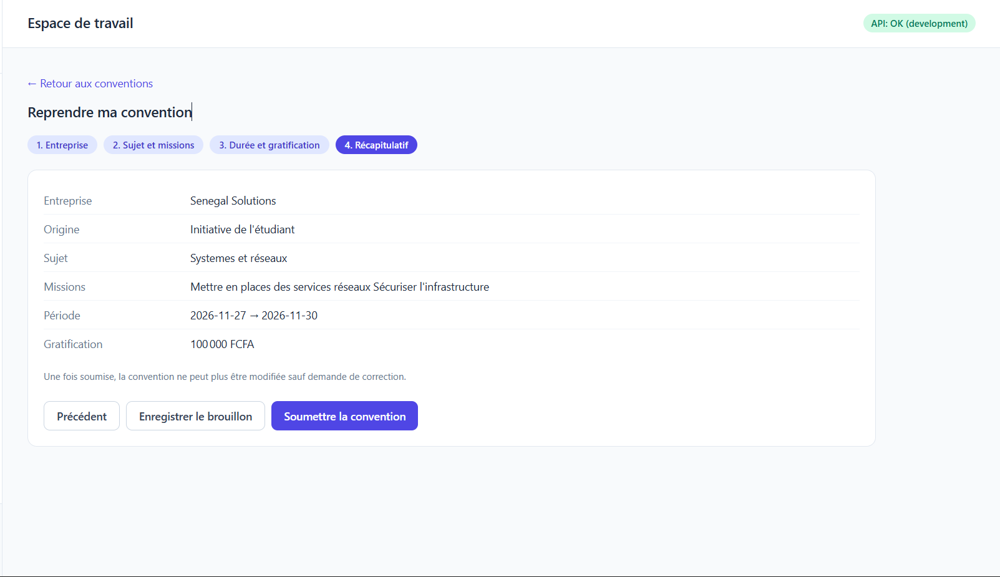

À la soumission, un champ manquant ramène à l'étape concernée.

## 4. Fiche d'une convention
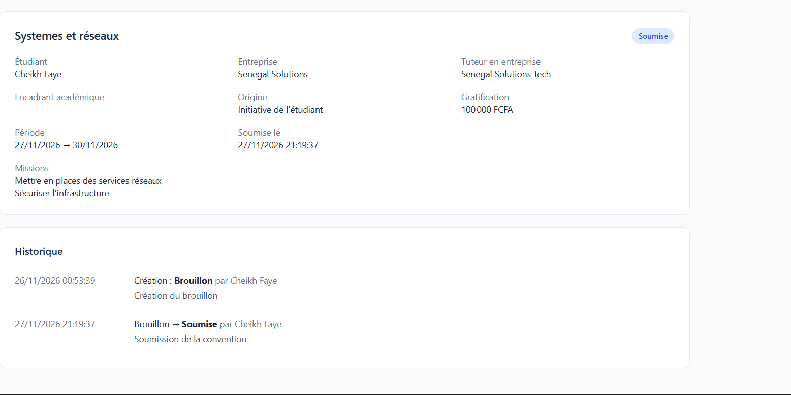

Statut, informations, motif éventuel et historique de chaque changement (qui, quand, avant, après, commentaire).

## 5. Liste à traiter (administration, encadrant)
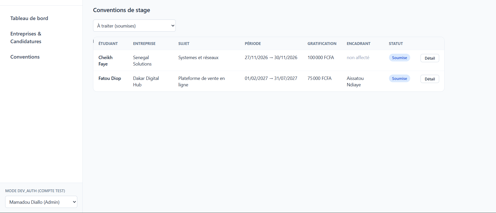

## 6. Décision

Valider, demander une correction ou refuser ; motif obligatoire pour les deux derniers. L'administration affecte aussi l'encadrant académique.